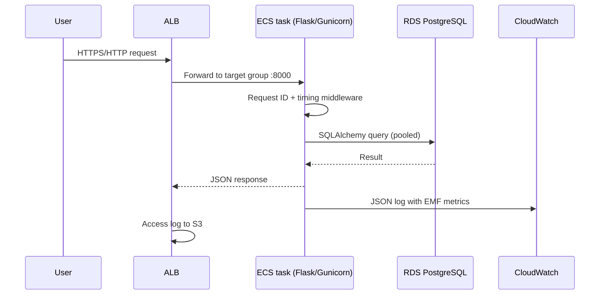
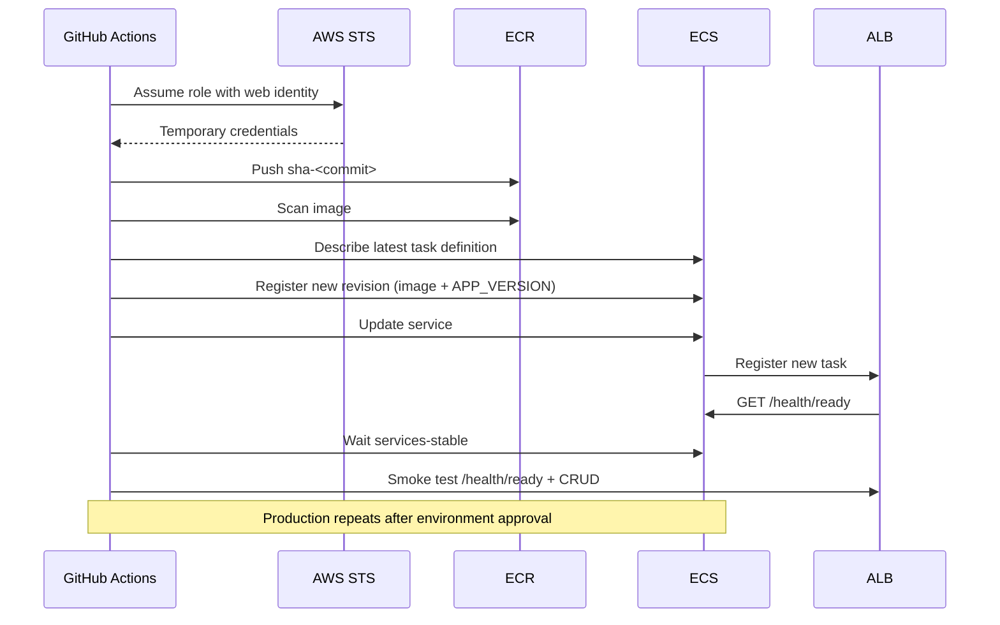

# Architecture Notes

## Request path



## Network layout

```text
VPC 10.0.0.0/16
├── public-1 10.0.0.0/20    ALB node, NAT gateway
├── public-2 10.0.16.0/20   ALB node
├── app-1    10.0.32.0/20   ECS task (no public IP)
├── app-2    10.0.48.0/20   ECS task (no public IP)
├── db-1     10.0.64.0/20   RDS (no public IP)
└── db-2     10.0.80.0/20   RDS standby / subnet group
```

The VPC has DNS support and hostnames enabled. An S3 gateway endpoint keeps ECR
layer downloads and other S3 traffic off the NAT gateway. All other AWS API
traffic (ECR API, Secrets Manager, CloudWatch Logs) uses HTTPS through NAT. A
production hardening step is to add interface endpoints for those services.

## Deployment flow



## Failure domains

| Failure | Detection | Behaviour |
|---|---|---|
| Application process exits | ECS task health check (`/health/live`) | ECS replaces the task |
| Application cannot reach DB | ALB health check (`/health/ready`) | Target removed from rotation; alarm on unhealthy hosts |
| Bad application release | ECS deployment circuit breaker | Rolls back to the previous task definition |
| RDS unavailable | Readiness + `DatabaseConnections`/CPU alarms | App returns 503 on readiness; tasks stay alive |
| AZ failure | Multi-AZ RDS in production; ALB across two public subnets | Production survives one AZ; staging is not HA by design |
| NAT failure | ECS task cannot reach AWS APIs | Tasks continue serving if their DB connection is already established; new pulls/log delivery fail. Production uses one NAT per AZ |
| Pipeline failure | Slack notification | Deployment stops before production approval |

## State and environments

Each environment root has its own S3 key and DynamoDB lock. The module is shared,
so a resource change is made once and planned/applied per environment. This is
preferred over Terraform workspaces because a `workspace select` mistake can apply
the wrong state to the wrong environment.

The ECS task definition is a Terraform-created bootstrap revision; CI owns the
live revision. The service's `task_definition` is in `ignore_changes`, and CI
reads the latest family before registering a new revision, so Terraform changes to
environment variables and secrets are picked up on the next deployment.

## Observability model

- **Logs:** JSON stdout -> CloudWatch Logs. Every request has a request ID, path,
  status, duration, and EMF block.
- **Metrics:** ALB/ECS/RDS native metrics plus custom `8Byte/App` EMF metrics.
- **Traces:** not implemented; OpenTelemetry is on the roadmap. The request ID is
  the correlation key available today.
- **Dashboards:** one for infrastructure health, one for application behavior.
- **Alarms:** SNS email; Slack is used by CI, not by CloudWatch. AWS Chatbot or a
  small Lambda can bridge CloudWatch alarms into Slack if desired.
